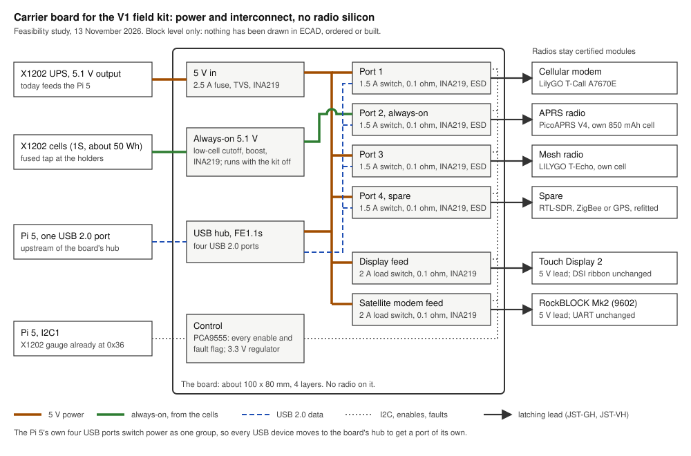

# Carrier board: feasibility study

SIDN fonds project 261042, deliverable D7. 13 November 2026.

The question: can one board that carries only power and interconnect, and no radio of its own, take away the failures the two V1 field kits logged? Every radio stays the certified module it is today, on a lead.

This is a study. Nothing in it has been drawn in ECAD, ordered or built.

**Verdict: go, with the three gates below.** Decided by Kyriakos Papadopoulos on 13 November 2026.

## What the kits logged

The requirements come from the device reliability log of the two field kits, tesseract and parallax, 5 September to 13 November 2026 ([export of 13 November 2026](https://github.com/meshsat/meshsat/tree/main/docs/evidence/device-log/2026-11-13), [docs page](https://docs.meshsat.net/reference/device-log)). A wedge is a device that stops answering until something resets it.

| # | Requirement | What the log shows | What the board does |
|---|---|---|---|
| R1 | A real power cut per USB port, with its current measured | In 102 wedges the watchdog tried a cut of the device's USB hub port. On the StarTech hubs that cut turned out to be a data reconnect: the device keeps its power (found 18 September 2026). In 17 more the step could not act at all, because the device had no switchable port (RTL-SDR 11, APRS radio 6): the Pi 5's own four USB ports switch power as one group. Five RTL-SDR wedges and one cellular modem wedge ended by hand. | Four ports, each with its own current-limited switch, shunt and monitor. A cut takes the power from one device, and the log reads its current. |
| R2 | 5 V for the APRS radio while the kit is off | 67 receive silences of the PicoAPRS; 65 ended with a press of its PTT button, which is inside the sealed case. The PicoAPRS runs on its own 850 mAh cell when USB power is gone, shuts down when the cell is empty, and only the PTT button turns it on again. The kit's USB ports have no power whenever the kit is off. | Port 2 is fed from an always-on 5.1 V rail, boosted from the X1202's cells, with a cutoff that leaves the kit enough charge to start. The Pi can still switch the port while it runs. |
| R3 | A power switch for the touch display | The watchdog does not watch the display. The project notes record three hangs that only a power cut cleared (24 April, 6 and 15 September 2026), each a power cycle of the whole kit, and dim panels caused by the display's 5 V lead (21 September). | The display's 5 V goes through a load switch and a monitor: the Bridge can restart the panel alone and see what it draws. |
| R4 | One fused, measured 5 V path | 4 September 2026: 202 power-loss events, a reboot and an audio interface off USB, from the wiring around the UPS board. 21 September: the dim panels. Both were found from symptoms, not from a number. | One fused and clamped 5 V input with its own monitor, and a monitor on every output, so a wiring fault shows as a current or a voltage. |
| R5 | Latching connectors | Five RTL-SDR wedges ended with a re-seat; the display's 5 V lead had to be moved by hand. | JST-VH for 5 V, JST-GH for USB and I2C. Both latch. |
| R6 | No radio silicon on the board | The brief: the radios stay certified modules. | The board carries a hub, switches, monitors, one boost converter and connectors. Cellular modem, APRS radio, mesh radio and satellite modem stay as they are. |
| R7 | A power switch for the satellite modem (optional) | Six Iridium modem wedges (9704: 5, 9602/9603: 1); none ended with a software step. | The RockBLOCK's 5 V through a second load switch, so the watchdog gets a hard reset for it. |

What the log cannot tell: it covers two development kits over about ten weeks, bench work included. The counts show where the hand work went, not failure rates in the field. 18 of the APRS silences started on both kits within two minutes of each other, which points at the channel rather than the radios; no board changes that.

## Why not the V2 boards

The V2 carrier set in this repository (`v2/`, the Peli 1450 generation, not built) carries radio silicon: its compute board holds LoRa, ZigBee and GNSS modules and 5G and WiFi cards, and its APRS board an SA868 transceiver. That fails the brief.

The nearest radio-free design is the power and I/O board for the Pi 5 and X1202 specified on 2 September 2026 (`v2/docs/MESHSAT-709-geometry-appendix.md`, sections 15 and 16): an FE1.1s hub, a TPS2065C switch and an INA219 per USB device, PCA9555 enables. This study reuses that design and leaves out its APRS board and battery bank.

## Block design

| Block | Content |
|---|---|
| 5 V in | From the X1202's 5.1 V output on a JST-VH lead. 2.5 A resettable fuse, 5 V TVS clamp, INA219. |
| USB hub | FE1.1s, four USB 2.0 ports, 12 MHz crystal. Upstream from one Pi 5 USB port on a JST-GH lead. Every device the kit has today is USB 2.0. |
| Ports 1 to 4 | TPS2065C (1.5 A limit, fault flag), 0.1 ohm shunt, INA219, USBLC6 ESD clamp, JST-GH. Port 1 cellular modem, port 2 APRS radio, port 3 mesh radio, port 4 spare for the RTL-SDR, ZigBee or GPS when one goes back in. |
| Always-on 5.1 V | A fused tap at the X1202's cell holders, reverse protection, a low-cell cutoff, a TPS61089 boost, INA219. Feeds port 2 only. Runs with the kit off. |
| Display feed, satellite modem feed | TPS22810 load switch (2 A), 0.1 ohm shunt, INA219, JST-VH. |
| Control | PCA9555 on the Pi's I2C: every enable and fault flag. A 3.3 V regulator for the board's logic. |

I2C addresses: PCA9555 at 0x20, eight INA219 at 0x40 to 0x47. The X1202's gauge stays at 0x36.

### Connectors

| Connector | Type | Goes to |
|---|---|---|
| 5 V in | JST-VH 2-pin | X1202 5.1 V output |
| Cell tap | JST-VH 2-pin | X1202 cell holders, fused at the holder |
| Upstream | JST-GH 4-pin | one Pi 5 USB port (lead with a USB-A plug) |
| Ports 1 to 4 | JST-GH 4-pin | each module's USB-C (lead with a USB-C plug) |
| Display | JST-VH 2-pin | Touch Display 2 5 V input |
| Satellite modem | JST-VH 2-pin | RockBLOCK Mk2 5 V |
| I2C | JST-GH 4-pin | Pi 5 header: 3.3 V, SDA, SCL, ground |

## Power budget

Advertised current read from both kits' USB descriptors on 13 November 2026, and the makers' figures where they publish one. Advertised is not measured: the peaks are still to be measured.

| Load | Advertised | Known maximum | Feed |
|---|---:|---|---|
| Cellular modem (T-Call A7670E) | 136 mA | Transmit bursts above that: a 600 mA port limit browned it out in April 2026 | Port 1, 1.5 A |
| APRS radio (PicoAPRS V4) | 100 mA | 500 mA from USB (maker) | Port 2, always-on |
| Mesh radio (T-Echo) | 100 mA | charging current to be measured | Port 3, 1.5 A |
| Spare (RTL-SDR V4 when refitted) | 500 mA | | Port 4, 1.5 A |
| Touch Display 2 | | to be measured | Display feed, 2 A |
| RockBLOCK Mk2 | | to be measured | Satellite feed, 2 A |

Today's three USB devices advertise 336 mA together; with the PicoAPRS at its maximum, 736 mA. Both are well inside a 2.5 A input. The X1202's peak output rating is still an open item in this repository (`v2`, open list item 11).

The always-on rail costs the pack about 0.57 W for every 100 mA at 5.1 V, with a 90 % boost. On a full pack of about 50 Wh that is roughly three and a half days at 100 mA, less what the cutoff keeps back for the kit to start. The PicoAPRS's own draw with a full cell decides the cutoff and how long a kit can be stored; it is the first thing to measure.

## Bill of materials

Full list: [`bom.csv`](bom.csv). Prices are single units, from JLCPCB's parts table (12 September 2026) and LCSC's listings (13 November 2026).

| Block | Parts | USD per board |
|---|---|---:|
| USB hub | FE1.1s, crystal | 0.86 |
| Ports and feeds | 4 x TPS2065C, 2 x TPS22810, 5 x USBLC6 | 3.18 |
| Sensing | 8 x INA219, 8 shunts | 5.08 |
| Always-on rail | TPS61089, P-channel FET (inductor and cutoff not priced) | 0.80 |
| Power in, control | 2 fuses, 2 TVS, PCA9555, 3.3 V regulator | 1.83 |
| Passives | capacitors, resistors | 3.37 |
| Connectors | 4 x JST-VH, 6 x JST-GH | 1.97 |
| **Priced lines** | | **17.09** |

Two lines are not priced yet: the boost inductor and the low-cell cutoff. Leads, assembly, VAT and shipping of parts are not included.

## Quotes

Bare boards, 100 x 80 mm, 4 layers, 1.6 mm, from the makers' public calculators on 13 November 2026. Detail and screenshots: [`quotes/`](quotes/quotes.md).

| Maker | Boards | Price | Shipping |
|---|---|---:|---:|
| JLCPCB | 5 | USD 8.00 | USD 26.08 |
| PCBWay | 5 | USD 32.20 | USD 26.55 (to the US) |
| Aisler | 3 | EUR 45.20, excl. VAT, ENIG | not stated |

Three boards (two kits and a spare), cheapest bare boards plus the priced parts: USD 34.08 + 3 x USD 17.09 = **about USD 85**, before assembly, leads and the two unpriced parts. Factory assembly can be quoted only once the design files exist.

## Off-the-shelf alternative

The Yepkit YKUSH3, EUR 124.99 from Yepkit's shop on 13 November 2026 (out of stock that day): a USB hub with three downstream ports, each with its own power switch, and one switchable 5 V output, driven from the Pi over USB. Two kits: EUR 249.98.

| Requirement | YKUSH3 | Carrier board |
|---|---|---|
| R1 power cut per port | yes, three ports | yes, four ports |
| R1 current measured | no | yes |
| R2 APRS radio powered with the kit off | no; needs a separate always-on source and a lead that takes power from it | yes |
| R3 display switch | yes, on its 5 V output | yes |
| R4 measured 5 V path | no | yes |
| R5 latching connectors | no, USB-A sockets | yes |
| R7 satellite modem switch | no | yes |

## Risks

- **Peaks not measured.** The modem's transmit burst, the T-Echo's charging current, the display and the RockBLOCK. Measured before the design is drawn.
- **A second load on the X1202's cells.** The tap needs its own fuse at the holder and a cutoff that leaves the kit enough to start. The X1202 stays the only charger: no second charger on the pack.
- **A power cut does not reset a device with its own cell.** The T-Echo and the PicoAPRS keep running on their cells; for them a cut only stops charging. Of today's three USB devices, the per-port cut helps the cellular modem; the RTL-SDR, ZigBee and GPS gain when they go back in. The mesh radio's wedges are already cleared by software (67 of 69).
- **Software.** The Bridge's device-health watchdog and the management agent have to learn the board's switches and record its readings in the device log. That is Bridge work, not in the board's price.
- **Assembly.** The boost converter is a QFN with a thermal pad: it wants a stencil and reflow, or factory assembly.
- **Where it sits.** A place on the kit's plates, on four M3 standoffs, still to be fixed against the kit's CAD (`v1/cad`).

## Recommendation

Go, with three gates before any money is spent:

1. Measure on the bench: the PicoAPRS's draw with its cell full, and the peaks of the modem, the T-Echo, the display and the RockBLOCK.
2. Draw the board, then get a factory assembly quote for three.
3. Kyriakos and Elli decide the spend.

Then build three, two kits and a spare, and fit one kit first, never in the week of a demo.

Why: the biggest item of hand work in the log, 65 PTT presses with the case opened, has no off-the-shelf answer that also measures current, and neither has the display. Three boards come to about USD 85 in priced parts and bare boards; the off-the-shelf hub covers less of the list for about EUR 250. A no-go keeps the kits as they are and leaves R2 and R3 to a lead from a separate always-on source and a power button.

**Verdict: go, with these three gates.** Decided by Kyriakos Papadopoulos on 13 November 2026.

## Files

- `README.md`: this study.
- `block-diagram.svg`: the block diagram.
- `bom.csv`: the bill of materials, with prices and their sources.
- `quotes/`: the bare-board quotes and their screenshots.
